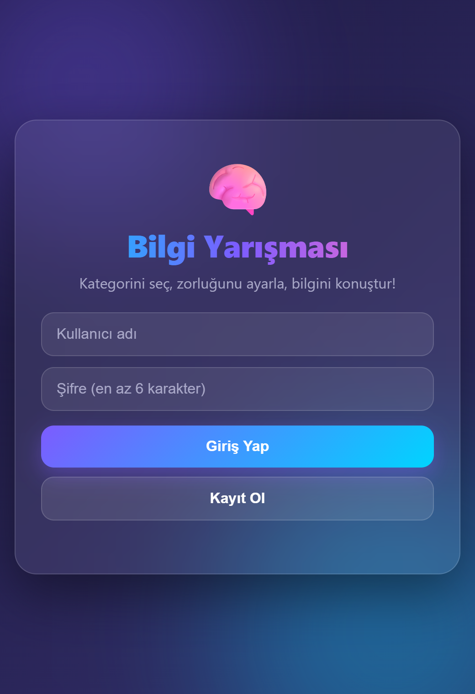
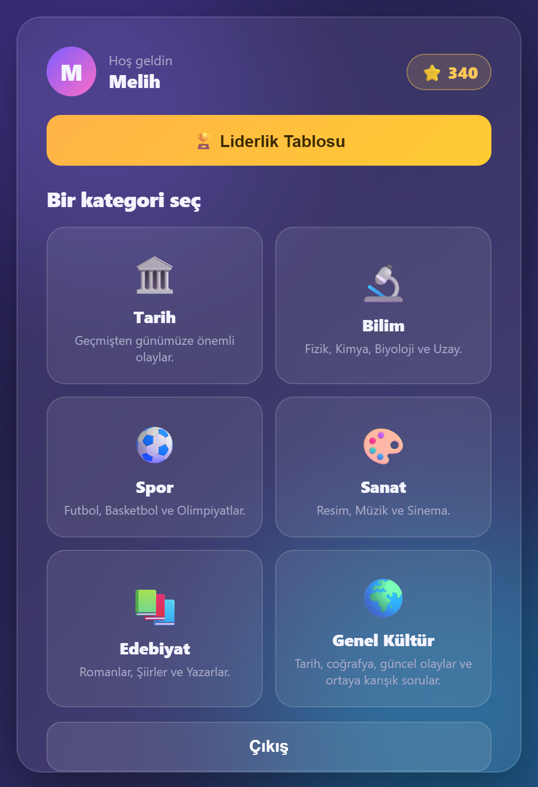
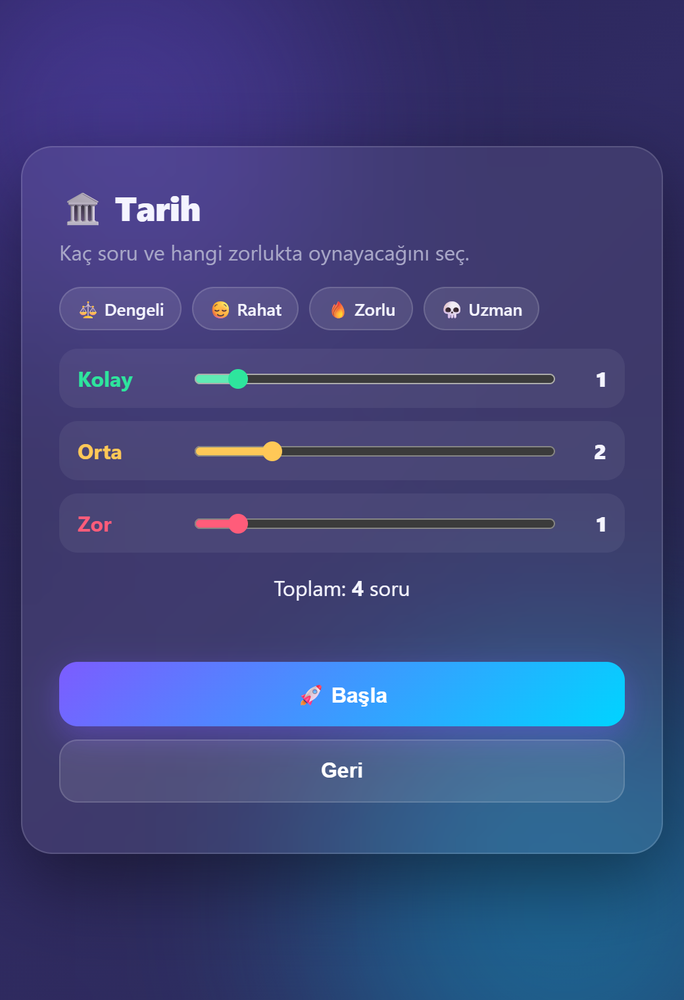
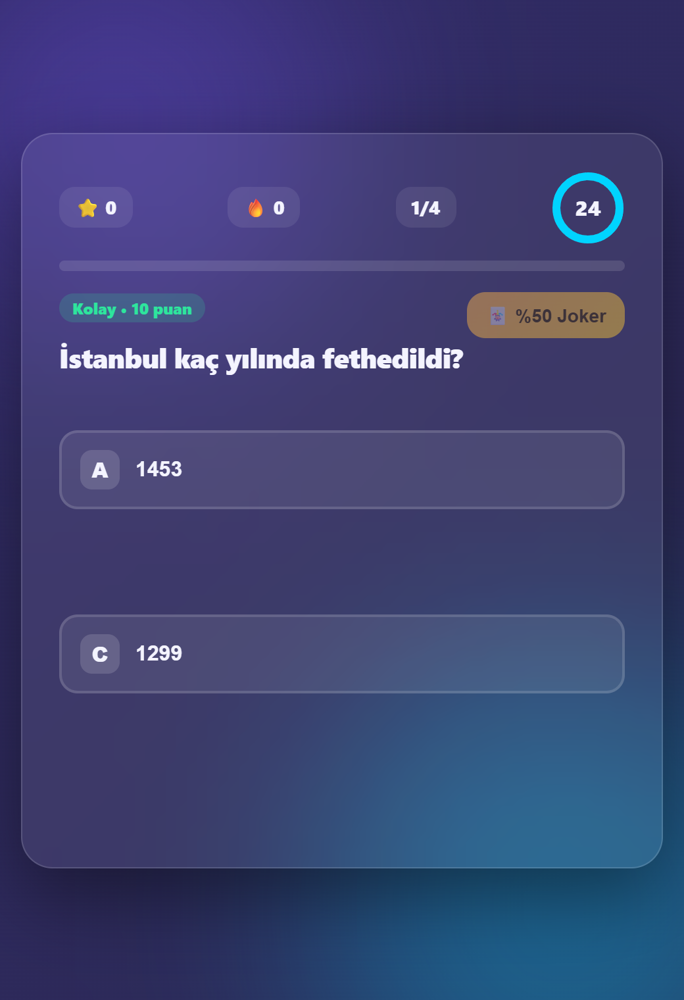
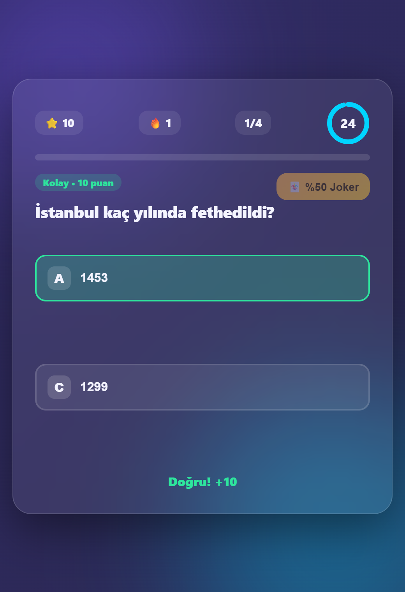
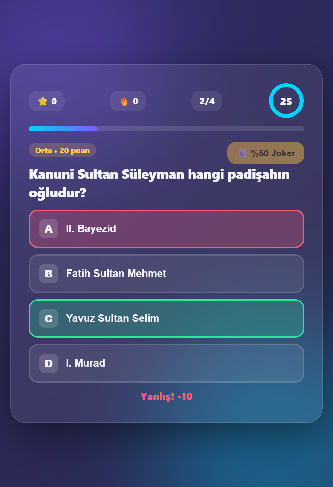
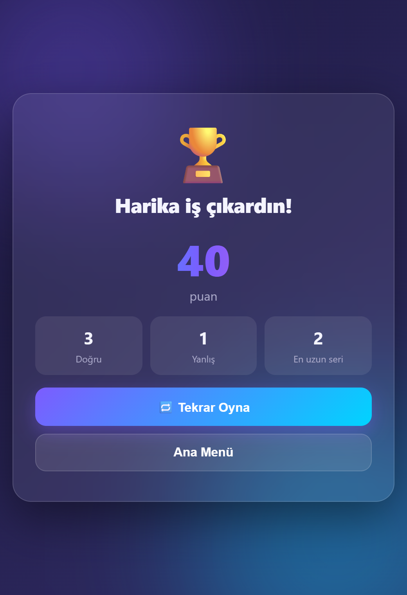
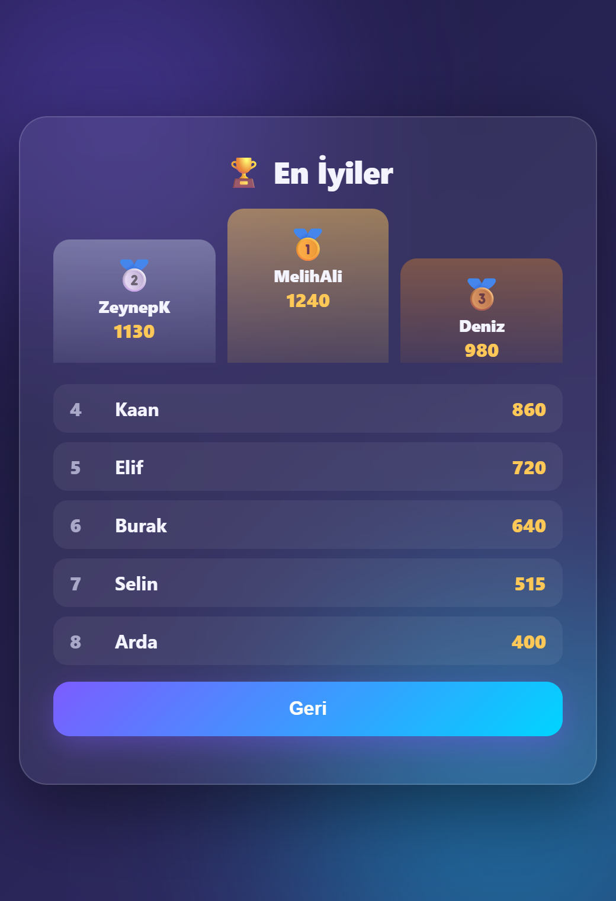
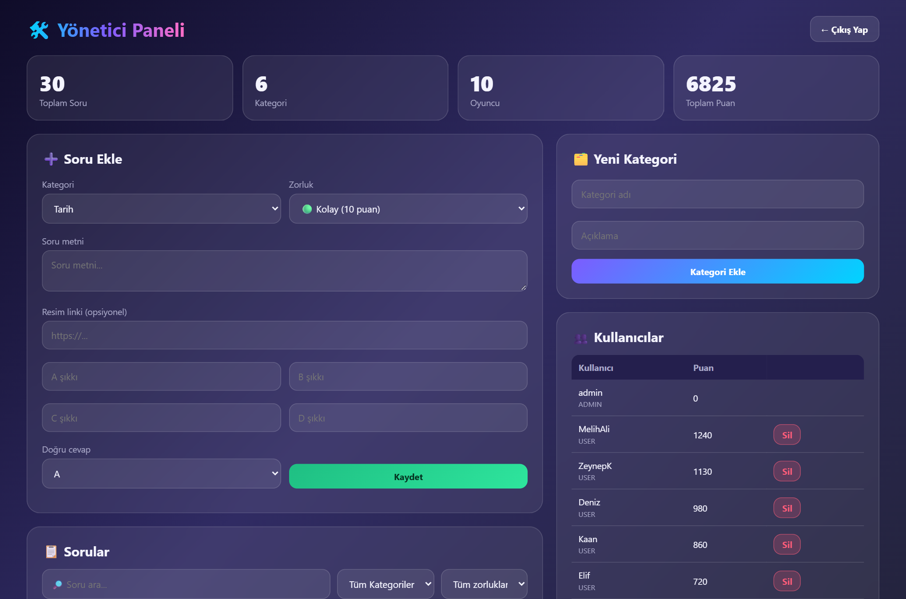

# 🧠 QuizSimulation — Bilgi Yarışması

Spring Boot ve PostgreSQL ile geliştirilmiş, modern arayüzlü bir bilgi yarışması uygulaması. Kategorini seç, zorluk dağılımını kendin ayarla, jokerini kullan ve liderlik tablosunda zirveye çık!

## 📸 Ekran Görüntüleri

<p align="center">
  
  
  
</p>
<p align="center">
  
  
  
</p>
<p align="center">
  
  
</p>

**Yönetici paneli**

<p align="center"></p>

## ✨ Özellikler

**Oyuncu tarafı**
- 🔐 Kayıt olma ve giriş yapma
- 🗂️ 6 kategori: Tarih, Bilim, Spor, Sanat, Edebiyat, Genel Kültür
- 🎚️ Kolay / Orta / Zor soru sayısını ayarlama ve hazır modlar (Dengeli, Rahat, Zorlu, Uzman)
- ⏱️ Her soru için 25 saniyelik animasyonlu sayaç (süre dolarsa soru yanlış sayılır ve doğru cevap gösterilir)
- 🃏 %50 jokeri (iki yanlış şıkkı eler)
- 🔥 Seri (streak) takibi ve oyun sonu istatistikleri (doğru, yanlış, en uzun seri)
- ⌨️ Klavye kısayolları: `A-D` veya `1-4` ile cevap verme
- 🖼️ Görselli sorular
- 🏆 Podyumlu liderlik tablosu (ilk 10)
- 🎉 Yüksek skorda konfeti
- 📱 Mobil uyumlu, koyu temalı cam efektli arayüz

**Yönetici paneli** (`admin` hesabı ile giriş)
- Anlık istatistikler (soru, kategori, oyuncu, toplam puan)
- Soru ekleme, silme, arama ve kategori/zorluk filtreleme
- Yeni kategori ekleme
- Kullanıcı listeleme ve silme

## 🎯 Puanlama

| Zorluk | Doğru | Yanlış / Süre doldu |
|--------|-------|---------------------|
| Kolay  | +10   | −5                  |
| Orta   | +20   | −10                 |
| Zor    | +30   | −15                 |

## 🛠️ Teknolojiler

- Java 17, Spring Boot 4 (Web MVC, Data JPA)
- PostgreSQL
- Saf HTML / CSS / JavaScript (ek bir framework gerektirmez)

## 🚀 Kurulum

### Gereksinimler
- JDK 17+
- PostgreSQL

### 1. Veritabanını oluştur
```sql
CREATE DATABASE trivia_db;
```

### 2. Şifreyi ortam değişkeni olarak ver
Uygulama, veritabanı şifresini `DB_PASSWORD` ortam değişkeninden okur (kullanıcı: `postgres`, adres: `localhost:5432`; ayarlar `src/main/resources/application.properties` içindedir).

```powershell
# Windows (PowerShell)
$env:DB_PASSWORD = "sifren"
```
```bash
# Linux / macOS
export DB_PASSWORD=sifren
```

### 3. Çalıştır
```bash
./mvnw spring-boot:run
```
Tarayıcıdan **http://localhost:8080** adresini aç.

Tablolar otomatik oluşturulur. İlk açılışta kategoriler, başlangıç soruları ve yönetici hesabı eklenir. Sonraki her açılışta eksik olan ek sorular da veritabanına yazılır (aynı soru ikinci kez eklenmez).

### Yönetici girişi
Kullanıcı adı `admin`. Şifre sabit değildir:

- `ADMIN_PASSWORD` ortam değişkenini (en az 8 karakter) tanımlarsan admin şifresi o olur.
- Tanımlamazsan ilk açılışta **rastgele güçlü bir şifre üretilir ve konsola yazılır**. Not almayı unutma.

```powershell
$env:DB_PASSWORD = "sifren"; $env:ADMIN_PASSWORD = "guclu-bir-sifre"; ./mvnw spring-boot:run
```

Eski sürümden gelen veritabanında admin şifresi hâlâ `123` ise açılışta otomatik olarak yenilenir.

## 🔒 Güvenlik

- Şifreler **BCrypt** ile hashlenir. Eski düz metin şifreler, kullanıcı ilk girişinde otomatik hashe çevrilir.
- **Spring Security** oturum (session) tabanlı yetkilendirme sağlar: oyun uçları için giriş, yönetici uçları için `ADMIN` rolü gerekir.
- Bir kullanıcı yalnızca kendi hesabına puan ekleyebilir.
- Kayıtta kullanıcı adı en az 3, şifre en az 6 karakter olmalıdır.
- API yanıtlarında şifre/hash dönmez; arayüzde kullanıcı girdileri HTML'den arındırılarak gösterilir.

## 🗄️ Soru bankası

Yaklaşık 12-13 yeni soru her kategoriye eklenmiştir ve kolay/orta/zor dağılımı vardır. Sorular [ExtraQuestionSeeder.java](src/main/java/com/beraber/triviaquiz/config/ExtraQuestionSeeder.java) içinde tanımlıdır. Yeni soru eklemek için bu dosyaya satır ekleyebilir ya da yönetici panelini kullanabilirsin.

## 🔌 API Özeti

| Metot | Adres | Açıklama |
|-------|-------|----------|
| GET | `/api/categories` | Kategorileri listeler |
| POST | `/api/categories` | Kategori ekler |
| GET | `/api/questions` | Tüm soruları listeler |
| GET | `/api/questions/start?categoryId=&easy=&medium=&hard=` | Özel oyun için rastgele sorular getirir |
| POST | `/api/questions/check` | Cevabı kontrol eder, puanı döner |
| GET | `/api/questions/joker/fifty-fifty/{id}` | Elenecek iki yanlış şıkkı döner |
| POST | `/api/questions` | Soru ekler |
| DELETE | `/api/questions/{id}` | Soru siler |
| POST | `/api/users/register` | Kayıt |
| POST | `/api/users/login` | Giriş (oturum açar) |
| POST | `/api/users/logout` | Çıkış |
| POST | `/api/users/score/{id}?score=` | Kendi hesabına puan ekler |
| GET | `/api/users/leaderboard` | İlk 10 oyuncu |

## 📁 Proje yapısı

```
src/main
├── java/com/beraber/triviaquiz
│   ├── config       # Veri yükleyiciler (DataSeeder, ExtraQuestionSeeder)
│   ├── controller   # REST uç noktaları
│   ├── service      # İş mantığı
│   ├── repository   # Spring Data JPA
│   ├── entity       # Category, Question, User
│   └── dto          # AnswerRequest, AnswerResponse
└── resources
    ├── application.properties
    └── static       # index.html (oyun), admin.html (yönetim paneli)
```

## 📝 Notlar

Bu proje bir öğrenme/hobi projesidir. Puan, oyun sonunda istemciden gönderildiği için kararlı bir hile koruması yoktur ve CSRF koruması kapalıdır (API yalnızca aynı siteden kullanılır). Gerçek bir yayından önce bunlar gözden geçirilmelidir.
